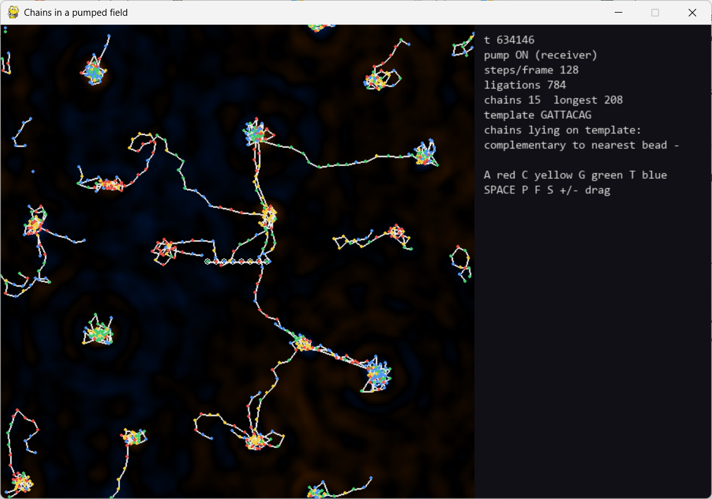

# Chains in a pumped GPU field



Oscillating monomers in a wave field, a pump at frequency 2Ω, and a single question:
**can complementary pairing, and with it copying, come out of wave physics instead of a rule table?**

This grew out of `train.html` (scouts writing into a Klein–Gordon field and walking on their
own wake, like Couder's walking droplets) and the Emergence repos (tokens as genes). DNA needs
three things the trains did not have: positions on a backbone, complementary pairing, and a
sequence-to-shape map. This repo goes after the first two.

## Results so far (Oct 28 2026, CPU, small worlds; all numbers in `results/`)

**In one line:** the pump produces real, strongly significant complementary *recruitment* at a
template, and short stretches of ordered copying appear. Faithful, reusable copies do not:
products grow on in the soup, pick up single-letter runs, and fail as templates in round 2.

### 1. Pairing comes out of the pump arithmetic (`experiments/pair_table.py`)

Two monomers pinned 2.5 cells apart, time-averaged force toward each other:

| pair | attraction |
|---|---|
| **A–T** | **+4.0×10⁻³** |
| **C–G** | **+4.0×10⁻³** |
| all 8 other pairs | between −8.6×10⁻⁵ and −5×10⁻⁶ |

About 45× selectivity. Two fixes were needed to get there, both physical: a monomer must not
hear its own voice (its own pumped self-field put G-like sidebands on C), and the phase
coupling must be weak enough that the near-miss A–G pair (off by 0.02) does not lock.

Fair caveat: the frequencies were *chosen* so that A+T = C+G = 2Ω. The alphabet did not discover
complementarity; what is shown is that a designed correspondence can be carried by dynamics
alone, with no table of who binds whom.

### 2. The templating gate (`experiments/gate.py`, 3 seeds, 40 000 steps, 4 templates per world)

Each distinct monomer that links next to a template is scored against the bead it sat against.
Chance is 25%.

| arm | links | monomers linked at a template | complementary | in ordered runs |
|---|---|---|---|---|
| **receiver** (pumped ears) | 162 | 102 | **60 (59%)** | 37 / 66 (56%) |
| medium (pumped mass term) | 293 | 100 | 22 (22%) | 11 / 59 (19%) |
| pump off | 0 | 0 | – | – |

Per seed (receiver): 25/44, 17/29, 18/29. Getting 60 or more of 102 by chance has probability
about 5×10⁻¹³. Pumping the medium links just as much but with no letter preference, and pump
off links nothing (nobody is held). So the selectivity comes specifically from the pumped ears.

Best ordered runs (consecutive beads, consistent direction): **CCGAA** against **AGCTT**
(CGAA/GCTT all correct), **GAA** against **CTT** (3/3).

**What fails:**
- **Round 2.** The longest chain made at a template, used as a new template: 3/22, 15/40, 0/8,
  pooled 18/70 = 26%, which is chance.
- **Runaway growth.** Chains seeded at a template keep growing in the soup (up to 34 long) and
  carry single-letter runs (CGAAAAAA, GGG...). Hypothesis, not yet measured: bonded monomers are
  3× louder, and the second-order same-letter coupling grows with amplitude, so chains leak a
  same-letter channel that the monomer pair table never sees.
- A mixed chain contains every letter, so it is complementary to everything. Chains are sticky
  to the whole alphabet, which is why dense worlds coarsen into clumps.

### 3. The soup (`experiments/soup.py`, `results/soup_probe.json`)

At higher density the soup wins: chains up to 66–78 long and multicoloured clumps. These
chains are random, not complementary ladders (6/39 cross-chain contacts complementary, below the
25% chance level). Dense clumps radiate visible rings: the pumped hearing creates sum frequencies
(e.g. 0.03 + 0.14 = 0.17) above the gap, which travel. The rings are exhaust; the pull toward a
clump is plain complement attraction to its many letters.

### What was fixed along the way (so the history is honest)

- **Stale-score ligation bug** (found by Astra): a pair could be bonded after it had left the
  backbone spacing. Now a bond needs the pair at spacing and both held *at that moment*. A
  regression test covers it. An earlier "11/13 = 85%" came from the buggy code with looser scoring
  and is withdrawn; it is kept only in `results/*_v1_single_template.json`.
- Pairing distance and backbone spacing overlapped (pairs were being linked as backbone);
  backbone moved to 3.6 ± 0.3.
- The pinned template does not link (it is the object under test).
- An early "medium copies the same letter" impression came from five runs; over all 59 ordered
  letters it is 17/59 (29%), not significant. Withdrawn.

### Modelling choices that are mine, not physics (named so nobody mistakes them)

- Emission is static and hearing is pumped: non-reciprocal, allowed for active particles.
- `chain_boost`: bonded monomers write louder. This is supplied positive feedback.
- `held_min`: only monomers locked to a partner may link (read from the field, not from letters).
- Linking is type-blind but needs a decaying co-residence score.

## Where this points

The world is good at growing sticky, wandering networks and bad at copying. Two directions:

1. **Copying:** a monomer locked to one partner should stop listening to others (saturation,
   the role the duplex plays in DNA), and chains should not get louder per letter. Then pump
   cycling (off: strands separate, on: copy) for a real round 2 without hand-built templates.
2. **Grow, then set, then compute:** let the network grow while fluid, then freeze positions the
   way perineuronal nets close a critical period, and test the frozen network as a reservoir
   (same experience → same response; different experience → different response; delayed
   products such as y_t = u_t·u_{t−d} with a linear reader, against shuffled and bare-field controls).


## The physics in one paragraph

The field is `train.html`'s update rule on a periodic N×N grid, with a small damping:

```
psi' = (2-γ)·psi − (1-γ)·psi_prev + c²·∇²psi − m²·psi + sources        (c² = 0.3, m² = 0.02, γ = 0.01)
```

The mass term opens a gap at ω₀ = arccos(0.99) ≈ 0.1415 rad/step. Every monomer oscillates
below the gap, so its field is a screened cloud a few cells wide rather than a travelling wave.

A monomer has a position, a phase θ and a natural frequency ω (its letter):

| letter | ω (rad/step) |
|---|---|
| A | 0.03 |
| C | 0.05 |
| G | 0.09 |
| T | 0.11 |

Each step every monomer

1. writes `g_emit · cos θ` into the field around itself;
2. hears the field there through a coupling that pulses with the pump, `c(t) = cos 2Ωt`;
3. lets what it hears pull its phase (the standard phase reduction of a driven oscillator);
4. is pushed by it: `F = k_force · c(t) · cos θ · ∇psi`.

Multiplying by `cos 2Ωt` turns a field oscillating at ω into one at 2Ω − ω with its phase
flipped. So the time-averaged force between two monomers is proportional to

```
⟨ cos 2Ωt · cos(ω_i t + φ_i) · cos(ω_j t + φ_j) ⟩
```

which is zero **unless ω_i + ω_j = 2Ω**. With 2Ω = 0.14 that picks out A+T and C+G and nothing
else. Identical letters average to zero; unrelated letters average to zero. Complements lock
their phases to φ_j = −φ_i (phase conjugation) and attract.

No table anywhere says A binds T. Move the pump and the pairing moves with it
(`Omega = 0.076` makes no pair sum to the pump at all, and that is one of the controls).

### Two ways to pump

- **receiver** (default): the monomers' "ears" pulse at 2Ω; the medium is static.
- **medium**: the field's mass term pulses (a Faraday medium, like the vibrating bath under
  walking droplets) and the ears are static. Here identical letters also couple directly at
  their shared frequency, which is the "attract your own kind" rule `train.html` had to
  hard-code. This variant is kept as a comparison.

Honest note on the model: emission is static and hearing is pumped, so the interaction is
non-reciprocal. These are active particles (each one keeps oscillating on its own), so that is
allowed, but it is a choice. Phase sensitivity (`g_phase`) and mechanical push (`k_force`) are
separate knobs for the same reason.

### Backbone bonds: type-blind

Two monomers with a free end may link when, right now, they sit at the backbone spacing
d₀ = 3.6 (±0.3), both are *held* (their running average of the pumped drive heard in phase with
their own oscillation exceeds `held_min`), and their co-residence score (+1 per check at the
spacing, decaying 3% per check) has passed `lig_score`. The rule never looks at letters. Each
monomer has two ends, so chains are linear. A free monomer drifting past is not held and scores
little; two neighbours held side by side on a template are and do. Pair partners sit at about
2.2 cells, well clear of the backbone window, so a pair is not mistaken for a backbone.

## Run it

```sh
pip install -r requirements.txt
python run.py                       # live viewer: GATTACAG template in a soup of monomers
python run.py --no-template         # soup only
python run.py --N 256 --n_each 600  # bigger world (GPU)
python experiments/pair_table.py    # which letters attract which
python experiments/gate.py --seeds 3 --round2                    # templating gate, receiver arm
python experiments/gate.py --seeds 2 --arms pump_off medium       # controls
python experiments/soup.py --seeds 1 --arms pump_on               # soup only
python -m pytest -q tests
```

Keys in the viewer: `SPACE` pause, `P` pump on/off, `F` field on/off, `+/-` speed, `S` screenshot,
left-drag stirs. Colours: A red, C yellow, G green, T blue; white lines are backbone bonds;
the template is ringed. The field view colours the field's sign (orange positive, blue negative),
not letters. Density decides the regime: `--N 256 --n_each 200` is the quiet copying regime,
`--n_each 600` grows the clump-and-string network.
